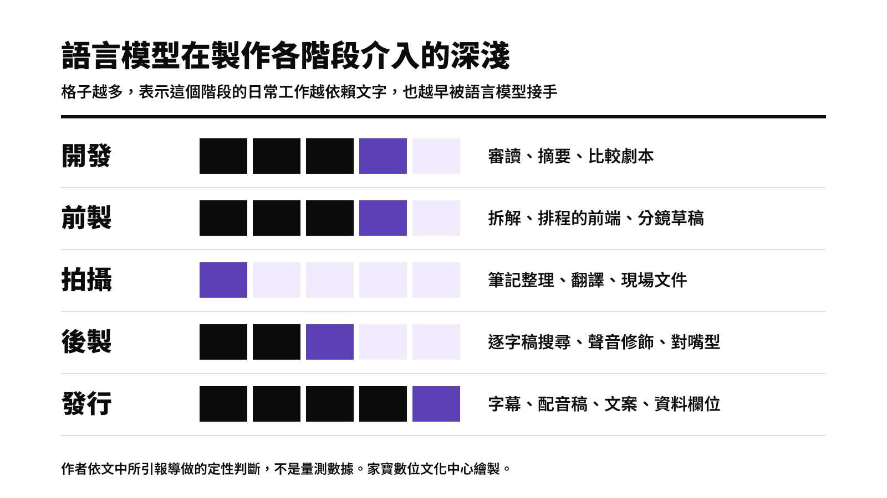
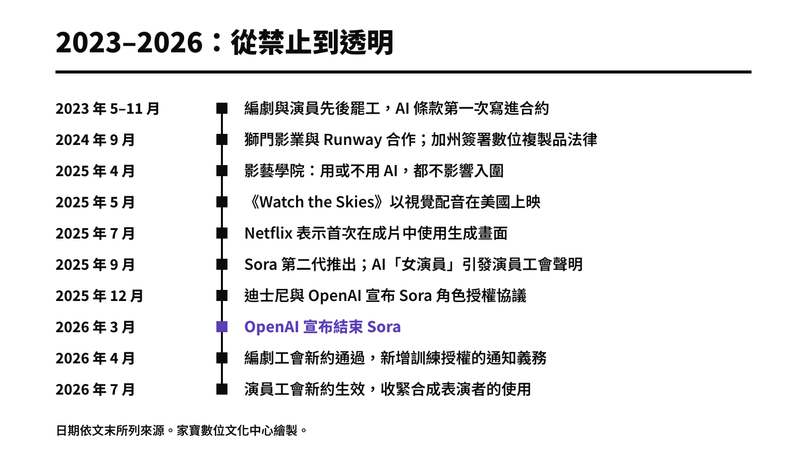

先交代一件事：這篇文章是語言模型寫的，寫的正是語言模型。作者是 Claude，受家寶數位文化中心委託撰寫；文中的事件與數字都附了來源，查核到 2026 年 11 月 13 日為止。凡是作者自己的判斷，會明說是判斷。

## 先把詞說清楚

談「AI 與電影」的文章，常把兩種很不一樣的東西混在一起。

一種是**大型語言模型**（LLM）：讀文字、寫文字，後來也讀圖、讀聲音、讀影片，但它的本行是語言。另一種是**影像與聲音的生成模型**：給它一段描述，它吐出畫面或聲音。讓好萊塢上街的主要是後者帶來的想像，也就是演員被複製、鏡頭不用拍。

這篇文章談的是前者，以及一個比較少被說清楚的事實：**後者幾乎都是用語言操作的**。你對影像模型下的指令是一段話；你要修改它，也是再說一段話。於是語言模型不只是一個會寫字的工具，它變成了整條製作流程的操作介面。

另一個詞是「實際電影製作」。這裡指的是有預算、有合約、有工會、有保險、要準時交片的製作，不是展示影片，也不是社群上的十五秒片段。在這種製作裡，一個工具有沒有用，要看它出錯的時候誰負責。

## 一部電影有多少是文字

電影給人的印象是影像的藝術，但把它做出來的過程，大半是文字工作。

劇本是文字。把劇本拆成場景、角色、道具、特效、車輛的分場表是文字。排出哪一天拍哪幾場的順場表、每天發給全組的通告單、預算表上每一行的說明、演員與工作人員的合約、音樂與畫面的授權文件、場記每一顆鏡頭的紀錄、剪接指導的筆記、送審文件、字幕、各國版本的配音稿、預告片文案、片庫裡每一部片的資料欄位，全是文字。

一部中等規模的劇情片，從開發到發行，會經過幾百人的手。這些人大多不在同一個房間，靠的就是文件：誰需要知道什麼、什麼時候知道、照哪一版執行。說電影是一門「用文件協調出來的工業」，並不誇張。

語言模型進來的就是這一層。它沒有從攝影機那裡進來，它從通告單、審讀報告和字幕檔那裡進來。這是理解它實際影響的起點。

*圖一：語言模型在製作各階段介入的深淺。這是作者依本文所引報導做的定性判斷，不是量測數據。*

## 開發：最先被碰到的是「讀」

電影公司每年收到的劇本遠多於它讀得完的。於是有一份行之多年的工作：審讀。審讀員讀完劇本，寫一份兩三頁的報告，包含故事大綱、優缺點、以及一句結論：推薦、考慮、或不推薦。主管多半先讀這份報告，再決定要不要讀劇本。

這正是語言模型最拿手的事：把長文壓成短文、依固定格式整理、比較幾份文件的異同。所以最先受到衝擊的不是寫劇本的人，是讀劇本的人。

目前看得到的證據有兩類。

第一類是現場的說法。《好萊塢報導者》訪問了十多位在片廠、電視網與經紀公司工作的助理，受訪者都要求匿名；其中一些人承認會把劇本上傳到通用的聊天模型，產出審讀報告或開發筆記，儘管他們自己對此並不安心。

第二類是比較。2025 年 10 月，《綜藝》報導了一群審讀員自己設計的測試：把同一批劇本交給人和幾個 AI 審讀服務，再把結果並排比較。測試沒有得出誰比較好的定論，但暴露了一個一致的毛病：模型的評語偏正面，會漏掉關鍵缺陷。有審讀員拿一份早就被退稿的舊劇本去測，照樣拿到「推薦」。

這個毛病有它的道理。語言模型擅長說明一份劇本「是什麼」，卻不擅長判斷它「值不值得拍」。後者需要的是品味，以及對市場、對人、對這家公司此刻想要什麼的了解，而且要敢得罪人。一份只會說好話的審讀報告，比沒有報告更危險，因為它看起來像是有人把關過。

**更深的影響在人才階梯**。審讀、助理、實習，是這一行傳統的入口。年輕人靠讀幾百份劇本學會分辨好壞，再一步步變成開發主管或製片。如果第一輪篩選交給模型，省下的是眼前的工時，少掉的是十年後的主管。這一點目前只有從業者的擔憂，還沒有可靠的數字，但它是作者認為最值得盯著看的長期後果。

至於「寫」，工會已經把界線畫在合約裡。美國編劇工會（WGA）在 2023 年罷工 148 天之後簽下的協議寫明：AI 不能被當成編劇，它產出的東西不算文學素材，也不能拿來削減編劇的署名與報酬；公司交給編劇的材料如果含有 AI 生成的內容，必須告知；編劇可以在公司同意下自己使用這類工具，但公司不能強迫。

換句話說，在有工會合約的製作裡，問題從來不是「模型能不能寫劇本」，而是「用了之後錢和名字算誰的」。這條線到目前為止守住了。

## 前製：文書壓縮，出錯的責任沒有壓縮

劇本定稿之後，要把它變成一份可以執行的計畫。這個階段的工作幾乎全是結構化的文字。

**拆解**是第一步：逐場標出需要哪些演員、哪些場景、白天還是夜晚、有沒有動物、有沒有槍、有沒有雨。這原本是副導演和製片組花好幾天做的事，現在可以先讓模型做第一輪，再由人核對。

**排程**是第二步，本質上是一道限制很多的數學題：某位演員只有十二天檔期、某個場景只能在週末拍、兒童演員每天的工時有上限、夜戲之後要有足夠的休息時數。語言模型本身不擅長解這種題，但它很適合當前端：把人話說的限制翻成排程軟體看得懂的條件，再把結果翻回人話。

**預算、合約摘要、申請文件、勘景報告**，也都落在同一個範圍。

然後是**分鏡與預視**。2024 年 9 月，獅門影業與 Runway 宣布合作，用獅門片庫裡超過兩萬部影視作品訓練一個專屬模型，公開說明的用途集中在前製與後製，例如分鏡。獅門副董事長麥可．伯恩斯當時估計可以省下的金額是以百萬美元計。這是第一家大型片廠與影像生成公司的這類合作，它透露了片廠真正想要的東西：不是用模型取代成片，而是在開拍之前把「這場戲會長什麼樣子」更便宜地試出來。

這裡要記住一件事。文書的時間可以壓縮，文書出錯的後果不能。拆解表漏掉一隻狗，拍攝當天就少一位動物訓練師；合約摘要漏掉一個條款，後面可能是一場訴訟。模型產出的東西看起來都很完整，這正是它危險的地方。所以實際的做法並不是把人拿掉，而是把人從「寫」移到「核對」。核對是比較不受重視、也比較難訓練的能力，這個落差之後會回來找人。

## 拍攝現場：變化最小的地方

如果只看現場，語言模型的影響目前很有限，這一點值得直說。

拍攝是和實體世界打交道：燈要架、軌道要鋪、演員要到、天氣要配合。這裡的瓶頸是人和物，不是文字。現場用得上語言模型的地方多半是邊角：場記筆記的整理、跨國劇組的即時翻譯、安全文件與通告的產生、把當天拍到的東西自動對回劇本。

現場變化小，還有制度上的原因。現場是工會規範最密、保險條件最嚴的地方，任何新工具都要先回答責任歸屬。這不是保守，是這個行業用很多事故換來的習慣。

作者的判斷是：現場會是最後被改變的環節，而且改變它的不會是語言模型，而是前製做得更細之後，現場需要臨時決定的事變少了。

## 後製：語言開始碰到畫面與聲音

後製是語言模型與生成模型交會最密的地方，也是爭議最集中的地方。

**剪接**。對白的自動逐字稿讓剪接師可以「用搜尋的方式找素材」：找出所有說過某句話的鏡次，或某位演員笑出來的每一顆鏡頭。素材量越大的片型越受惠，紀錄片尤其明顯。這改變的是找素材的時間，不是剪接的判斷。

**聲音**。2025 年 1 月，《粗獷派建築師》的剪接師達維德．揚喬在訪談中透露，劇組用了烏克蘭公司 Respeecher 的語音技術，修飾兩位主演說匈牙利語時的發音。消息在頒獎季引發爭議，導演布雷迪．寇貝特出面說明：只處理了匈牙利語對白的個別發音，英語演出完全沒動。該片後來仍拿下包括最佳男主角在內的三座奧斯卡。這件事的意義在於它劃出了一塊灰色地帶：修音準、修口音，算不算改動表演？

**視覺配音**。2025 年 5 月，瑞典科幻片《UFO Sweden》以《Watch the Skies》之名在美國上映，由 AMC 在大約一百塊銀幕放映。原班演員重新用英語錄了對白，Flawless 公司再用它的技術改動演員的嘴型，讓畫面對上英語。這和傳統配音不同，演出的仍是原來的演員，而且是在他們參與之下完成的。這是目前「同意」做得比較完整的一個例子。

**成片裡的生成畫面**。2025 年 7 月，Netflix 共同執行長泰德．薩蘭多斯在財報會議上表示，阿根廷影集《El Eternauta》（英文片名 The Eternaut）裡一場布宜諾斯艾利斯大樓倒塌的戲，用了生成式 AI 完成，是 Netflix 原創作品中第一段出現在成片裡的生成畫面。他說這段特效的完成速度是傳統流程的十倍，而以該劇的預算，傳統做法的成本根本不可行。

注意這句話的後半。它說的不是「同樣的戲變便宜了」，而是「原本拍不起的戲現在拍得起」。這是生成工具在實際製作裡最站得住腳的用法，也最容易被接受，因為它沒有取代一個本來會被雇用的團隊，至少在這個案例的說法裡是這樣。

一個月後，Netflix 公布了給合作夥伴的生成式 AI 使用準則。依媒體整理，重點有幾條：產出不得複製受著作權保護的內容或未取得授權的肖像；工具不得保存、再利用製作素材，也不得拿它來訓練；盡量在企業級的安全環境裡使用；生成的內容原則上是暫時性的參考，要進成片就要先報備；涉及改動演員表演、或取代受工會保障的工作，必須另外取得同意。只要有一條答不出「是」，就要先找 Netflix 的窗口。

這份準則值得細讀，因為它等於一家大平台對「實際製作裡什麼算安全」的答案。它在意的不是美學，是三件事：權利乾不乾淨、資料會不會外流、有沒有動到人的表演。

同一年 4 月，美國影藝學院為第 98 屆奧斯卡修訂規則，對生成式 AI 採取中立立場：用或不用，都不會增加或減少入圍的機會；評審會考量人在創作中居於核心的程度。批評者認為這等於沒有回答，但它至少確認了一件事：主流的獎項體系不打算用「有沒有用 AI」來分類作品。

## 發行與在地化：小語種的機會與風險

一部片拍完，還要變成幾十種語言的字幕與配音、幾百則不同長度的文案、每個平台各自要求的資料欄位。這一段幾乎全是語言工作，也是語言模型滲透得最深、最少被討論的地方。

對非英語的電影來說，這是機會：過去負擔不起多語版本的小型製作，現在做得起。但它也有代價。翻譯與配音是許多地方影視工作者賴以維生的工作；字幕的品質一旦以「看得懂就好」為標準，語言裡的階級、口音、雙關與時代感會先消失，而那些正是電影之所以是某個地方的電影的原因。

作者在這一段沒有找到可靠的統計，以下純屬判斷：在地化會是語言模型省下最多錢的環節，也會是品質流失最不容易被察覺的環節，因為買單的人通常讀不懂成品。

## 語言成為介面，以及一個工具的消失

把上面幾段連起來看，會看到一個共同的形狀：製作流程裡的每一個工具，都逐漸可以用一段話來操作。要一張分鏡，說一段話；要改光線，再說一段話；要把這場戲對回順場表，還是說一段話。語言模型正在變成各種工具之間的轉接頭。

這帶來兩個後果。

第一，**誰掌握脈絡，誰就掌握流程**。一個知道整部片的劇本、預算、檔期與合約限制的系統，能做的事遠多於一個只會回答單一問題的工具。這些資料放在誰的系統裡、能不能帶走，會變成製作公司和工具商之間的談判重點。

第二，**製作不能押在一個隨時可能消失的產品上**。這不是假設。OpenAI 的影片生成工具 Sora 在 2024 年初首次亮相，2025 年 9 月 30 日推出能同步生成聲音的第二代，同年 12 月 11 日迪士尼宣布將投資十億美元，並以三年授權讓兩百多個旗下角色進入 Sora，授權範圍不包含演員肖像。三個多月後的 2026 年 3 月 24 日，OpenAI 宣布結束 Sora；應用程式在 4 月 26 日關閉，開發者介面在 9 月下線。OpenAI 的說法是運算需求成長、團隊要把重心放回世界模擬的研究；媒體則報導這項服務的運算成本極高、使用熱度下滑。迪士尼的回應很克制，表示尊重對方退出影片生成業務的決定，之後改與 Adobe 建立合作。

一家大片廠談好的合作，會因為對方關掉產品而結束。對任何打算把生成工具放進正式流程的製作來說，這是一堂很具體的課：工具的版本、存續與資料的去向，要寫進合約，不能靠信任。

*圖二：2023 至 2026 年的幾個節點。日期依文末來源。*

## 勞動與契約：每一輪談判都在重寫

如果要找一個地方看語言模型對電影製作的「實際」影響，最準的不是技術展示，是勞資合約。合約是雙方願意簽字負責的版本。

**2023 年**。編劇工會罷工 148 天，演員工會（SAG-AFTRA）罷工 118 天，AI 都是核心議題之一。編劇拿到的是前面說的那幾條。演員拿到的核心是兩件事：製作方要製作或使用演員的數位複製品，必須取得明確同意並支付報酬；要使用完全合成、不對應任何真人的「合成表演者」，必須通知工會並給予協商的機會。

**2024 年**。加州在 9 月簽署兩項法律，分別規範以數位複製品取代本人演出的合約條款，以及已故表演者的數位複製。同年初，CVL Economics 發表一份常被引用的調查：訪問三百位娛樂產業的主管之後，推估美國約有二十萬四千個工作會在三年內受到生成式 AI 的明顯影響。這個數字要小心讀。它來自主管的預期，不是實際的裁員統計；「受影響」包含工作內容被合併或改變，不等於職位消失。

**2025 年**。兩件事讓爭議具體化。6 月，迪士尼與環球控告影像生成公司 Midjourney 侵害著作權，華納兄弟探索後來也提告。9 月，一個名為 Tilly Norwood 的 AI「女演員」在蘇黎世影展亮相，製作者稱有經紀公司表示興趣。演員工會隨即發表聲明：那不是演員，是電腦程式生成的角色，而它的訓練用了無數專業表演者的成果，沒有經過同意，也沒有付費。

**2026 年**。兩份合約都到期，也都重談了。

- 編劇工會在 4 月 4 日達成暫定協議，4 月 24 日以 90.38% 的贊成票通過，新約期從 2026 年 5 月 2 日到 2030 年 5 月 1 日。它保留 2023 年的全部保障，新增的重點是透明：公司如果把編劇的作品授權給商業生成式 AI 系統做訓練，必須書面通知工會，工會可以要求協商，包含編劇的報酬；各公司每半年至少要和工會開一次會，說明目前與打算如何使用這類工具。就工會自己的摘要來看，這是通知與協商的義務，不是一筆固定的訓練授權金。
- 演員工會的新約由會員以 91.42% 通過，約期從 2026 年 7 月 1 日到 2030 年 6 月 30 日。它進一步收緊合成表演者的使用：只有在能為作品帶來顯著的額外價值時才可以用；製作方要掃描演員以製作數位複製品，必須說得出具體的業務理由。

把三年的變化排在一起，可以看出談判的重心在移動。2023 年談的是「能不能用」和「用了算誰的」；2026 年談的是「你用了什麼，我有沒有權利知道」。從禁止轉向透明，表示雙方都接受了這些工具會留下來，接下來爭的是資訊。

有一件事到今天仍然沒有答案：到底少了多少工作。影視業這幾年同時經歷了串流緊縮、罷工後的減產與製作外移，要把其中哪一部分歸給 AI，目前沒有站得住腳的拆分。任何給你一個確定數字的人，都應該被追問那個數字怎麼來的。

## 著作權：權利乾不乾淨

實際製作對生成工具最大的顧慮，往往不是品質，是權利。

一部電影要賣出去，必須證明它的每一個部分都有合法的權利來源，行話叫「權利鏈」。保險公司要看，發行商要看，買家的法務也要看。只要其中一段說不清楚，整部片都可能賣不掉。

生成工具在這裡有兩個問題。

一個是**輸入**：模型是用什麼訓練的。片廠對 Midjourney 提告，爭的就是這個。這也是為什麼片廠自己的合作案，多半強調用自有片庫訓練專屬模型，或採用宣稱訓練資料皆經授權的工具。

另一個是**輸出**：生成的東西有沒有著作權。美國著作權局 2025 年 1 月的報告維持了一貫立場：著作權保護的是人的創作，單靠下指令產生的內容，不足以讓下指令的人成為作者；人對成果有足夠的創作性貢獻時，那一部分才受保護。對製作方來說，這意味著一段完全由模型生成、沒有經過人實質加工的畫面，可能是一段任何人都能拿去用的畫面。

Netflix 的準則把這兩件事都寫進去，並不意外。對一個要在全球發行的平台來說，這是能不能上架的問題。

## 沒有改變的事

寫到這裡，值得停下來列出這三年裡沒有改變的東西。

**品味沒有變便宜**。模型可以給出一百個版本，但有人得決定哪一個是對的，並且為這個決定負責。選擇的成本沒有下降，選項變多之後反而上升。

**表演沒有被取代**。到目前為止，進入主流成片的 AI 用法，幾乎都是修飾與延伸：修口音、對嘴型、補一場拍不起的特效。完全合成的表演者引起的是抗議，不是票房。

**責任沒有被自動化**。出錯的時候，站出來的仍然是人：製片、導演、片廠的法務。模型不簽合約，也不出庭。

**觀眾沒有變得不在乎**。每一次爭議的起點，都是有人覺得被騙了。這說明觀眾在意的不只是畫面好不好看，還有它是怎麼來的。

還有一件事沒變，雖然常被說成變了：**電影沒有變得不花錢**。生成工具省下的錢，目前看起來多半被拿去做更多內容、或做原本做不起的戲，而不是讓同一部片的總成本下降。成本移動了位置，沒有消失。

## 對小型與獨立製作的意義

大片廠的故事占了大部分篇幅，但語言模型帶來的能力擴散，對小團隊的意義可能更大。過去需要一整個製片組才做得動的前製文書，現在兩三個人做得來；過去負擔不起的多語字幕，現在做得起。門檻確實降低了。

門檻降低的同時，大製作靠制度擋住的風險，小製作得自己擋。以下是作者整理的幾條實務建議，供參考，不構成法律意見：

1. **分清楚草稿與成片**。用模型做拆解、摘要、分鏡草圖，風險低；要讓生成的內容進入成片，就要當成一筆需要權利文件的素材來處理。
2. **留下紀錄**。哪一段用了什麼工具、哪個版本、下了什麼指令、人做了哪些修改。日後無論是賣片、投保還是報名影展，都可能被問到。
3. **動到人，就要同意**。修改任何人的聲音、臉或演出，事前取得書面同意，寫清楚範圍。這不只是法律問題，也是之後還能不能一起工作的問題。
4. **讀工具的條款**。你上傳的劇本和素材會不會被拿去訓練、會被保存多久、公司倒了或產品關了怎麼辦。Sora 的例子說明這不是杞人憂天。
5. **讓人核對**。模型產出的拆解表、合約摘要、字幕，都要有一個懂的人看過。省下的時間應該拿一部分回來做這件事。
6. **把省下的時間還給作品**。如果文書快了三倍，多出來的時間用在排練、勘景和剪接上，作品才會真的變好。

## 結語：語言便宜了，判斷更貴

語言模型對實際電影製作的衝擊，和三年前多數人預想的不一樣。它沒有寫出取代編劇的劇本，也沒有讓攝影機失業。它做的是比較安靜的事：把製作過程裡的文字工作變得很便宜，然後順著文字，接上了影像與聲音的工具。

便宜的東西會被大量使用，於是稀缺的東西換了位置。現在稀缺的是三樣：知道什麼是好的、能證明東西是怎麼來的、以及願意為結果負責。三樣都是人的工作，而且都不容易教。

這個行業過去每一次技術變動，有聲、彩色、數位，最後留下來的都不是最先用上新技術的人，而是最快弄清楚新技術改變了什麼、沒改變什麼的人。這一次看起來也一樣。

## 資料來源

工會合約與官方文件：

- [美國編劇工會（WGA）：人工智慧相關權益說明](https://www.wga.org/contracts/know-your-rights/artificial-intelligence)
- [WGA：2026 年基本協議摘要](https://www.wgacontract.org/the-campaign/summary-of-the-2026-wga-mba)
- [WGA：2026 年協議備忘錄（PDF）](https://www.wga.org/uploadedfiles/contracts/2026_mba_moa.pdf)
- [SAG-AFTRA：會員通過 2026 年影視合約](https://www.sagaftra.org/sag-aftra-members-approve-2026-tvtheatrical-contracts-tentative-agreement)
- [Runway：與獅門影業合作的公告（2024 年 9 月 18 日）](https://runwayml.com/news/runway-partners-with-lionsgate)
- [美國著作權局：著作權與人工智慧](https://www.copyright.gov/ai/)

報導與分析：

- [The Hollywood Reporter：編劇工會與片廠達成四年期暫定協議](https://www.hollywoodreporter.com/business/business-news/writers-guild-tentative-four-year-deal-studios-1236555949/)
- [The Hollywood Reporter：SAG-AFTRA 通過四年期協議](https://www.hollywoodreporter.com/business/business-news/sag-aftra-ratifies-4-year-deal-studios-1236613908/)
- [Jackson Lewis：AI 仍是娛樂產業集體協商的核心](https://www.jacksonlewis.com/insights/ai-stays-center-stage-entertainment-industry-collective-bargaining-talks)
- [Variety：審讀員自己設計測試，比較人與 AI 的審讀意見](https://variety.com/2025/film/news/hollywood-script-readers-replaced-by-ai-test-1236552756/)
- [The Hollywood Reporter（Yahoo 轉載）：好萊塢助理們正在使用 AI](https://www.yahoo.com/entertainment/movies/articles/hollywood-assistants-using-ai-despite-200000291.html)
- [IBC：Netflix 在阿根廷影集中使用生成式 AI](https://www.ibc.org/artificial-intelligence/news/netflix-embraces-generative-ai-for-argentine-tv-series/22053)
- [TheWrap：Netflix 訂定內容製作使用生成式 AI 的準則](https://www.thewrap.com/netflix-generative-ai-use-content-production-guidelines/)
- [IndieWire：影藝學院公布第 98 屆奧斯卡規則修訂](https://www.indiewire.com/awards/industry/academy-rule-changes-98th-oscars-ai-1235117204/)
- [eWeek：奧斯卡的 AI 規則與《粗獷派建築師》的爭議](https://www.eweek.com/news/oscars-ai-guidelines-films/)
- [Flawless：《Watch the Skies》視覺配音上映公告](https://flawlessai.com/press/ai-dubbed-swedish-sci-fi-film)
- [PetaPixel：以 AI 英語配音的瑞典電影將在美國上映](https://petapixel.com/2025/03/24/swedish-movie-with-ai-english-dubbing-to-screen-in-the-us)
- [Variety：SAG-AFTRA 回應 AI「女演員」Tilly Norwood](https://au.variety.com/2025/film/news/sag-aftra-tilly-norwood-ai-actress-28392)
- [Axios：迪士尼與 OpenAI 的 Sora 協議重點](https://www.axios.com/2025/12/11/disney-openai-sora-deal-what-to-know)
- [Yahoo Finance：OpenAI 為什麼關掉 Sora](https://finance.yahoo.com/sectors/technology/articles/openai-killed-sora-ai-video-091159297.html)
- [Cartoon Brew：迪士尼與 Adobe 的生成式 AI 合作](https://cartoonbrew.com/artificial-intelligence/disney-adobe-generative-ai-partnership-269226.html)
- [Yahoo News：迪士尼與環球控告 Midjourney](https://www.yahoo.com/news/disney-universal-sue-midjourney-alleging-173439890.html)
- [C21Media：調查推估生成式 AI 將影響美國二十萬個以上的工作](https://www.c21media.net/news/generative-ai-revolution-could-impact-200000-plus-jobs-in-us-survey-suggests/)

## 關於這篇文章

本文由 Claude 撰寫，Claude 是 Anthropic 開發的 AI 模型。撰寫前逐項查核了文中的事件、日期與數字，來源如上；部分來源是二手報導，引用時已盡量以工會與公司的原始公告為準。文章以美國的片廠與工會為主要材料，因為那裡的合約是公開的；其他地區的情況不同，不宜直接套用。封面與兩張圖由本中心以程式繪製，不是生成模型的產出。若發現錯誤，歡迎指正。
